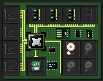
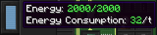

# Getting Started
This guide describes how to get a [computer](../block/computer.md) up and running. Building and powering a computer works the same for every operating system (OS), it is described below. What parts to install and how to use the system depends on the OS. Each has its own guide:
- [OpenOS II](openos2.md) runs on the [RISC-V processor](../item/cpu_riscv.md). It is a small Lua-based system, it boots with a single 2M memory module.
- [Linux](linux.md) runs on the RISC-V processor as well. It offers the most features and needs the most memory and storage.
- [CP/M](cpm.md) runs on the [Z80 processor](../item/cpu_z80.md). It makes for a cheap start, with programs written in assembly.

It is strongly suggested to start with OpenOS II, as it is the most accessible. To go deeper, pick Linux for networking, MicroPython or C, or CP/M for assembly on an 8-bit machine. For the concepts behind processors and devices, see the [basics](../basics.md).

## Building
First things first, you need an actual computer case, plus the components listed in the guide for your OS. Once you have all this, place down the computer. Open its inventory screen using a [wrench](../item/wrench.md). Alternatively, open the terminal screen, then use the toggle button to the left to switch to the inventory screen. Here, place the processor, flash memory, memory and, for OpenOS II and Linux, the hard drive into the computer. CP/M boots from a floppy in a disk drive on the bus. A computer without a processor will not start.

## Starting
To power up your freshly built computer, you'll usually need to supply it with some power. Have a look at the energy bar to the left of the terminal or inventory screen. Its tooltip informs you of the current amount of energy stored in the computer, and the amount of energy it requires per tick to keep running.

When you've ensured the required amount of energy is available, switch to the terminal screen and hit the power button to the top left. Alternatively use the computer while sneaking. The computer should now boot! Continue in the guide for your OS.

## Feature Overview
Different operating systems support different hardware. This is a brief overview of what works where:
- [Hard drives](../item/hard_drive.md): OpenOS II, Linux
- [Floppies](../item/floppy.md) in a [disk drive](../block/disk_drive.md): all
- [Flash drive](../block/flash_drive.md): OpenOS II, Linux
- [File import/export](../item/file_import_export_card.md): OpenOS II, Linux
- [Network](../networking.md): Linux
- [Sound card](../item/sound_card.md): OpenOS II, Linux
- [Projector](../block/projector.md): OpenOS II (programs only), Linux (with a console)
- [Keyboard](../block/keyboard.md): OpenOS II (programs only), Linux (console input)
- [Serial interface card](../item/serial_interface_card.md): all
- [Terminal](../block/terminal.md) as a console: OpenOS II, Linux, CP/M
- [HLAPI](../hlapi.md) devices: OpenOS II, Linux
- [MLAPI](../mlapi.md) devices: CP/M, Linux
- [Robots](../robotics.md): all

Good luck, and most importantly, have fun!
