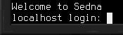

# Linux
Linux runs on the [RISC-V processor](../item/cpu_riscv.md). It is a small distribution with the common command line tools from busybox, Lua, MicroPython and the `tcc` C compiler. It supports every device in this manual.

## Parts
Build the computer as described in [getting started](index.md), using these parts:
- 1x [computer](../block/computer.md)
- 1x [RISC-V processor](../item/cpu_riscv.md)
- 1x **Sedna Firmware** [flash memory](../item/flash_memory.md), crafted from flash memory and a RISC-V processor
- 1x **Sedna Linux** [hard drive](../item/hard_drive.md), crafted from an 8M hard drive and a RISC-V processor
- 3x 4M [memory](../item/memory.md)

Linux needs at least 8M of memory, 10M are highly recommended.

## Logging In
Power the computer, turn it on and wait until you're prompted for a login.

Enter `root` as the user name and press enter. The `root` account has no password.

## The System
The shell and most tools come from busybox, so the usual commands such as `ls`, `cp`, `cat` and `less` work as on any other Linux. To edit files, use `vi` or `nano`.

To run a Lua script, use `lua script.lua`. Run `lua` without arguments for the interactive prompt. MicroPython works the same, via `micropython`. Compile and run C programs with `tcc -run program.c`.

To turn the computer off from the shell, run `poweroff`. `reboot` restarts it.

## Drives
The boot drive is `/dev/vda`. Additional [hard drives](../item/hard_drive.md), [disk drives](../block/disk_drive.md) and [flash drives](../block/flash_drive.md) follow as `/dev/vdb`, `/dev/vdc` and so on.

They are *not* automatically mounted. Use `mount /dev/vdb /mnt/data` to mount tem. The directory must exist and should be empty. Use `umount /mnt/data` unmounts it.

A new drive needs a file system first. Run `mke2fs /dev/vdb` to create one. Formatting a drive *erases all data on it!*

Floppies can be swapped at any time. Unmount before removing a floppy, to avoid data loss.

## Devices
To control devices such as the [redstone interface](../block/redstone_interface.md) from Lua or MicroPython, use the `devices` library, see the [high-level API](../hlapi.md). C programs can also use the [mid-level API](../mlapi.md). `lsdev` lists the connected devices.

The built-in file system at `/mnt/builtin` also provides `import` and `export` for the [file import/export card](../item/file_import_export_card.md), and the `robot` library for [robots](../robotics.md).

## Clocks
Computers provide two hardware clock (RTC) devices. The first one counts time in a scale most users will think in. It is used by default, for example by `date` and `time`. The second one measures time as it works in the world the computer runs in. To obtain the current world time, use `hwclock -f /dev/rtc1`.
